<div align="center">


# Vectus SAT · Sistema de Alerta Temprana

**Detecta las vulnerabilidades que CISA confirma como explotadas, decide cuáles importan
y avisa a los clientes con el formato Vectus, sin intervención manual.**


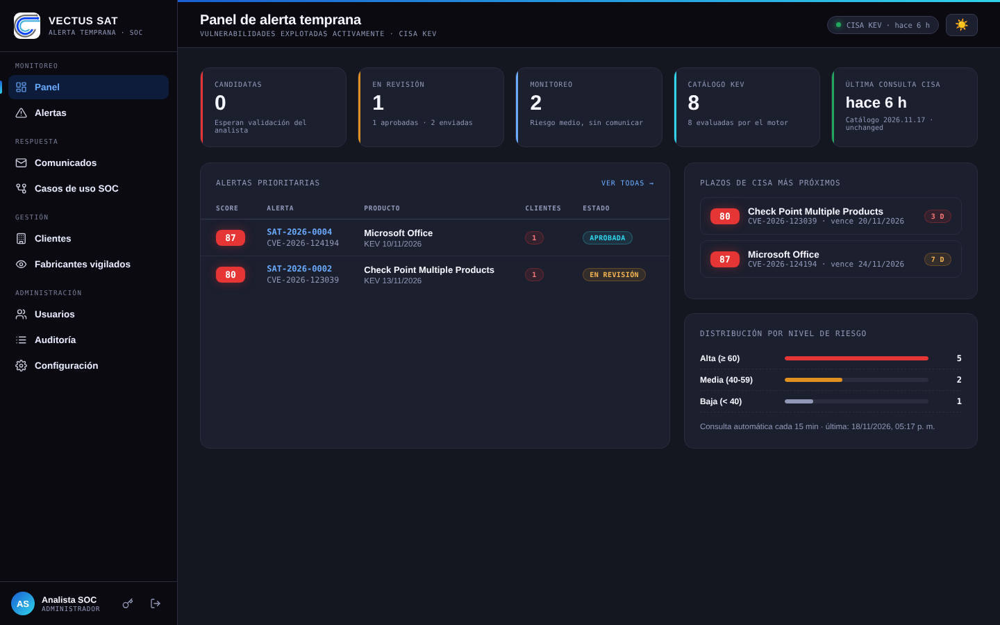

</div>

---

## Contenido

- [Qué hace](#qué-hace)
- [Cómo funciona](#cómo-funciona)
- [Capturas](#capturas)
- [Arquitectura](#arquitectura)
- [Instalación](#instalación)
- [Operación diaria](#operación-diaria)
- [Configuración](#configuración)
- [Seguridad](#seguridad)
- [Estructura del repositorio](#estructura-del-repositorio)
- [Solución de problemas](#solución-de-problemas)

---

## Qué hace

| | |
|---|---|
| 🛰️ **Monitorea CISA KEV** | Consulta el catálogo de *Known Exploited Vulnerabilities* cada 15 minutos y detecta altas y cambios. |
| 🎯 **Filtra lo que importa** | Enriquece cada CVE con **NVD** (CVSS) y **EPSS** y calcula un puntaje de 0 a 100. Solo lo significativo genera aviso. |
| ✉️ **Notifica automáticamente** | Arma el **newsletter HTML** (cuerpo del mail) y el **informe de impacto PDF** (adjunto) con la identidad Vectus y los envía a todos los contactos de clientes activos. |
| ⏱️ **Ventana de revisión del SOC** | El SOC recibe el comunicado primero y tiene 30 minutos para revisarlo, editarlo o cancelarlo antes de que salga. |
| 🛡️ **Protección Fortinet específica** | Consulta **FortiGuard** y agrega las firmas reales de IPS, antivirus, EDR y outbreak de cada CVE, más recomendaciones de hardening. |
| 🧭 **Caso de uso SOC por alerta** | Genera `CU-SOC-NNN` con el proceso SOC (responsables y plazos), el flujo del ataque (MITRE ATT&CK), el playbook y un **runbook técnico** con consultas para Splunk, Sentinel, Wazuh, FortiSIEM, QRadar, Elastic, FortiGate, Palo Alto, Check Point, Defender y más. |
| 🖥️ **Consola web** | Panel, alertas, comunicados, casos de uso, clientes y contactos, usuarios con roles, auditoría y configuración. Modo oscuro y claro. |

---

## Cómo funciona

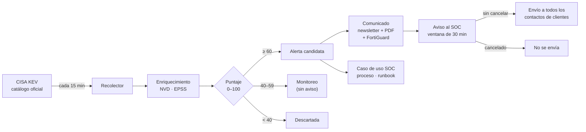

### Línea de tiempo de una alerta

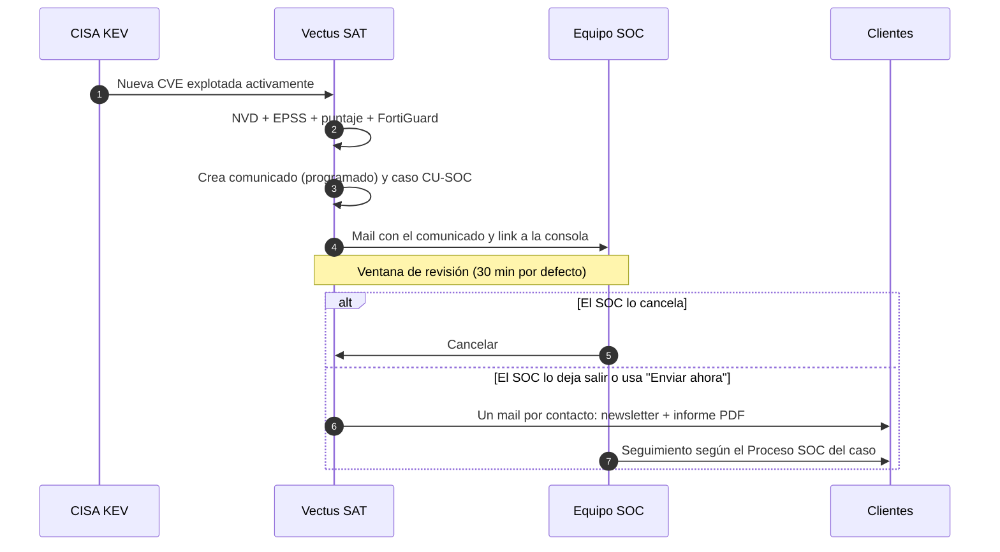

### Puntaje

| Criterio | Puntos |
|---|---:|
| Está en CISA KEV (explotación confirmada) | 20 |
| Fabricante vigilado: tier 1 / tier 2 | 20 / 10 |
| Coincide con la tecnología de un cliente (+5 si está expuesta a internet) | 25 (+5) |
| Tipo de falla (RCE, bypass de autenticación, etc.) | hasta 15 |
| Usada en campañas de ransomware | 10 |
| EPSS alto / medio | 10 / 5 |
| CVSS crítico / alto | 10 / 5 |
| Explotable por red y sin autenticación | 5 |
| Plazo de CISA de 7 días o menos | 5 |

**≥ 60** se notifica · **40–59** queda en monitoreo · **< 40** se descarta automáticamente. Los umbrales se cambian en el `.env`.

---

## Capturas

<table>
<tr>
<td width="50%"><b>Comunicado</b>: editor y vista previa del mail<br>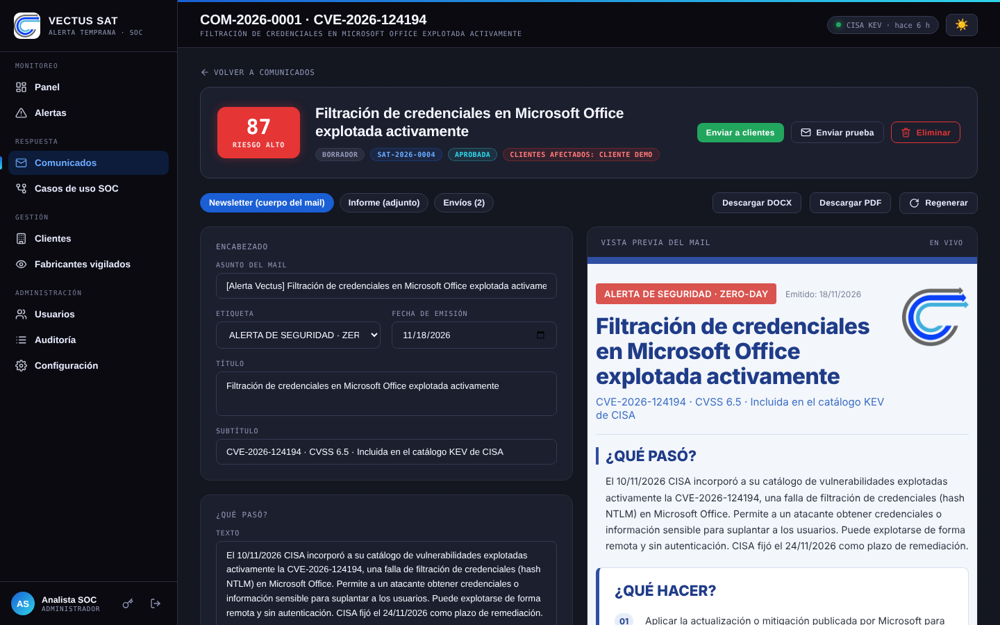</td>
<td width="50%"><b>Proceso SOC</b>: qué hace el equipo, quién y en qué plazo<br>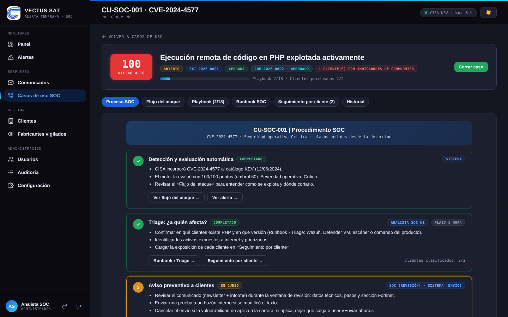</td>
</tr>
<tr>
<td><b>Flujo del ataque</b>: etapas MITRE y dónde cortarlo<br>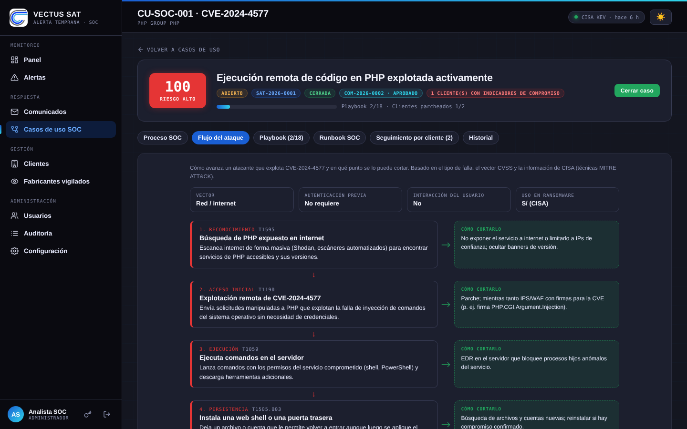</td>
<td><b>Runbook SOC</b>: consultas por herramienta<br>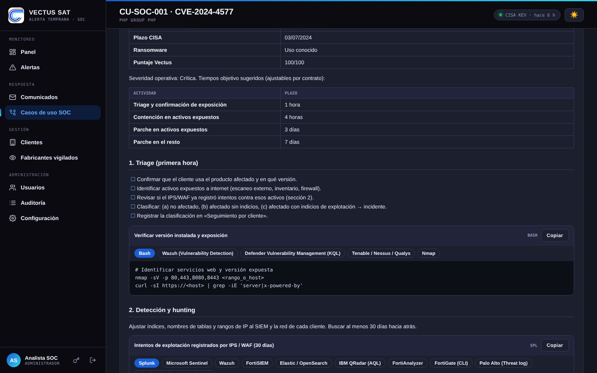</td>
</tr>
<tr>
<td><b>Alertas</b>: priorizadas por puntaje<br>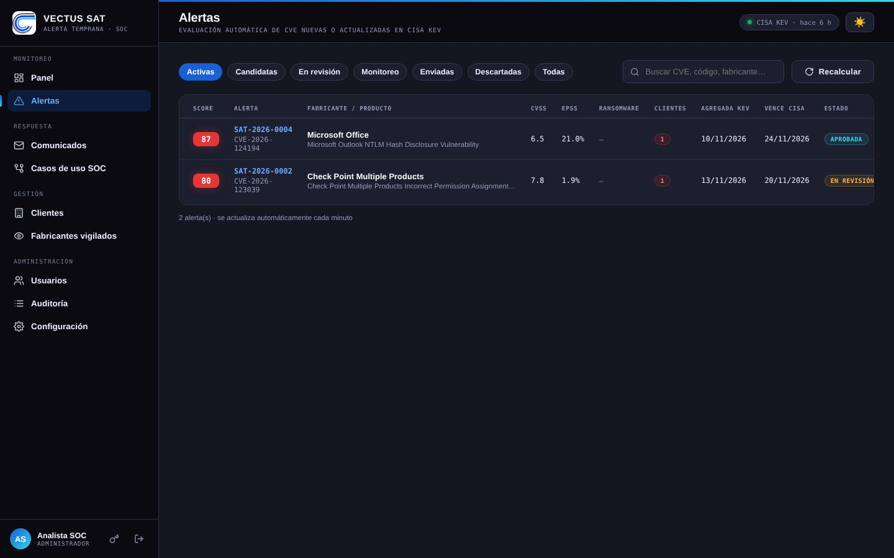</td>
<td><b>Detalle de alerta</b>: desglose del puntaje<br>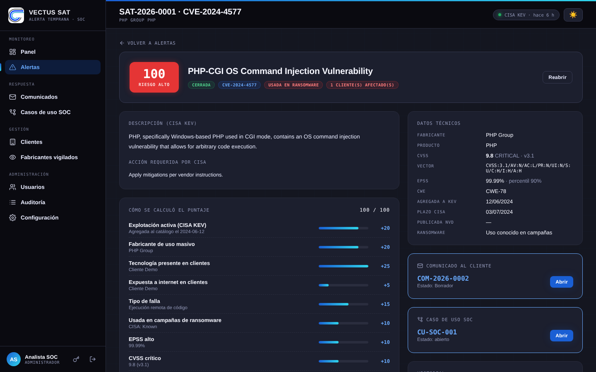</td>
</tr>
<tr>
<td><b>Clientes</b>: varios contactos por cliente<br>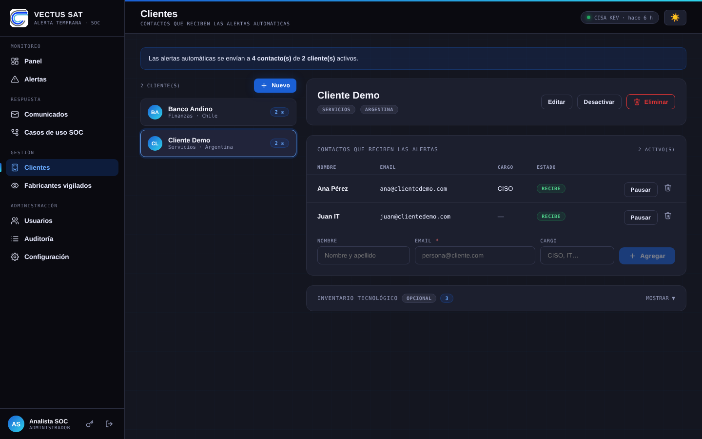</td>
<td><b>Configuración</b>: envío automático y emails del SOC<br>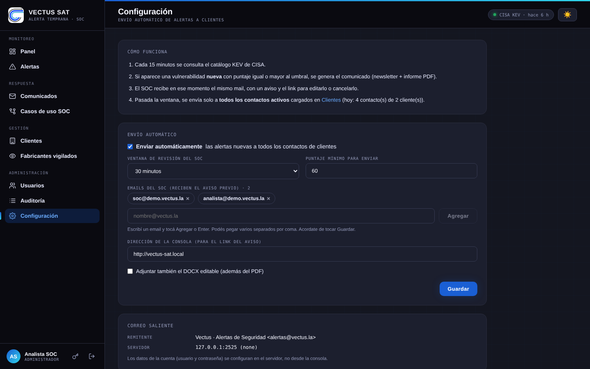</td>
</tr>
<tr>
<td><b>Modo claro</b><br>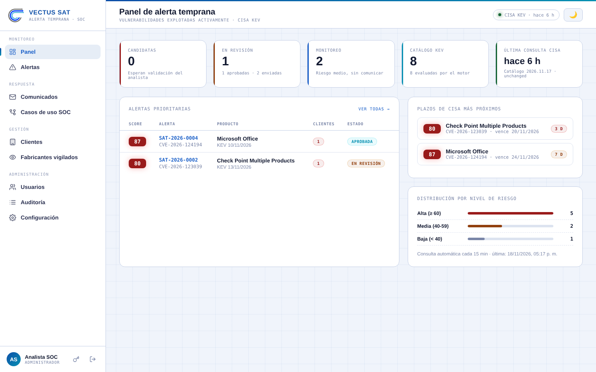</td>
<td><b>Ingreso</b><br>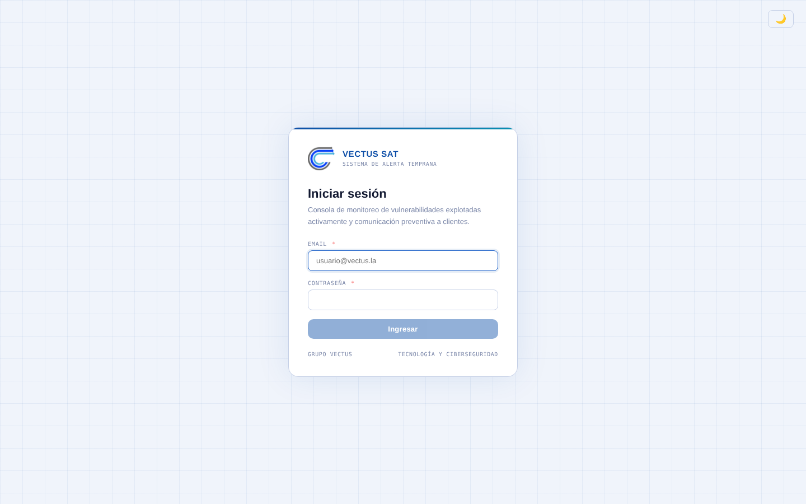</td>
</tr>
</table>

---

## Arquitectura

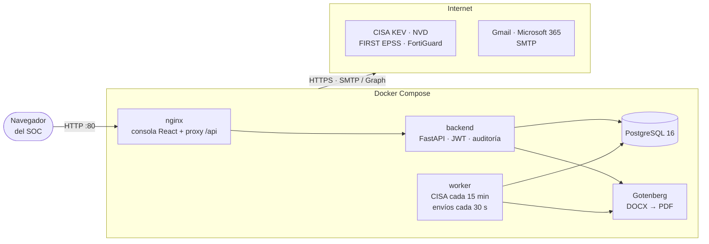

| Servicio | Imagen | Función |
|---|---|---|
| `nginx` | nginx 1.27 + build de Vite | Sirve la consola y hace de proxy a la API. Es el único puerto publicado. |
| `backend` | python 3.12 | API REST (FastAPI + SQLAlchemy), autenticación, comunicados y casos de uso. |
| `worker` | la misma que el backend | Recolector KEV, puntaje, programación y despacho de envíos. |
| `db` | postgres 16-alpine | Persistencia en `./data/postgres`. |
| `gotenberg` | gotenberg 8 | Convierte el informe DOCX a PDF (LibreOffice). Solo es accesible por la red interna. |

---

## Instalación

### Requisitos

- Ubuntu 22.04 o 24.04 (cualquier Linux con Docker sirve), 2 vCPU, 4 GB de RAM y 10 GB de disco.
- **Docker Engine** con el plugin **Compose v2**.
- Salida a internet hacia `cisa.gov`, `nvd.nist.gov`, `api.first.org`, `fortiguard.com` y el servidor de correo.
- Una cuenta de correo para enviar: Gmail con **contraseña de aplicación**, Microsoft 365 (Graph) u otro SMTP.

<details>
<summary><b>Instalar Docker en Ubuntu</b></summary>

```bash
sudo apt-get update && sudo apt-get install -y ca-certificates curl git
sudo install -m 0755 -d /etc/apt/keyrings
sudo curl -fsSL https://download.docker.com/linux/ubuntu/gpg -o /etc/apt/keyrings/docker.asc
echo "deb [arch=$(dpkg --print-architecture) signed-by=/etc/apt/keyrings/docker.asc] \
https://download.docker.com/linux/ubuntu $(. /etc/os-release && echo $VERSION_CODENAME) stable" \
| sudo tee /etc/apt/sources.list.d/docker.list > /dev/null
sudo apt-get update && sudo apt-get install -y docker-ce docker-ce-cli containerd.io docker-buildx-plugin docker-compose-plugin
sudo systemctl enable --now docker
```
</details>

### Instalación guiada

```bash
sudo git clone https://github.com/Rodrigo-Vectus/Alerta-temprana.git /opt/vectus-sat
cd /opt/vectus-sat
sudo ./install.sh
```

El instalador pregunta todo lo necesario. **Las contraseñas se escriben sin mostrarse en pantalla.**

| Paso | Qué pregunta |
|---|---|
| 1 · Instancia | Nombre de la instalación, puerto web, URL de la consola y zona horaria |
| 2 · Administrador | Correo y contraseña inicial (o la genera al azar) |
| 3 · Equipo SOC | Correos que reciben el aviso previo |
| 4 · Correo | **Gmail**, **Microsoft 365 (Graph)**, **Microsoft 365 por SMTP**, **otro SMTP** o configurarlo más tarde |
| 5 · Opciones | API key de NVD (opcional), umbrales e intervalo de consulta |

Después:

1. Genera las claves internas (base de datos y sesiones) al azar y escribe el `.env` con permisos `600`.
2. Construye y levanta los contenedores y espera a que la API responda.
3. **Verifica las credenciales de correo** y ofrece mandar un mail de prueba.
4. Espera la primera descarga del catálogo de CISA, que queda como línea base y no genera avisos.
5. Ofrece cargar retroactivamente las KEV de los últimos N días. Esto no envía nada.
6. Borra la contraseña inicial del `.env` una vez creado el administrador.

Al final muestra la URL y el usuario. En el primer ingreso la consola pide cambiar la contraseña. El siguiente paso es cargar **clientes y contactos** en la sección *Clientes*.

> Si volvés a ejecutar `./install.sh` con un `.env` existente, podés **mantenerlo** y solo actualizar los contenedores, o **reconfigurar**. Al reconfigurar se conservan las claves de la base y se guarda una copia `.env.bak.*`.

<details>
<summary><b>Gmail: cómo obtener la contraseña de aplicación</b></summary>

1. En la cuenta de Google que va a enviar, activá la **verificación en dos pasos**.
2. Entrá a <https://myaccount.google.com/apppasswords>, creá una con el nombre "Vectus SAT" y copiá las 16 letras.
3. Pegala cuando `install.sh` la pida (con o sin espacios).

Gmail siempre envía como la cuenta autenticada. El límite de una cuenta común ronda los 500 destinatarios por día. Para volúmenes mayores conviene Google Workspace o Microsoft 365.
</details>

<details>
<summary><b>Microsoft 365: Graph (recomendado)</b></summary>

Microsoft está deshabilitando el SMTP AUTH con usuario y contraseña. Con Graph:

1. En **Entra ID › Registros de aplicaciones**, creá una app nueva.
2. En **Permisos de API**, agregá Microsoft Graph › **Permisos de aplicación** › `Mail.Send` y otorgá el consentimiento de administrador.
3. En **Certificados y secretos**, creá un secreto de cliente.
4. En `install.sh` elegí la opción 2 e ingresá el Tenant ID, el Client ID, el secreto y el buzón remitente.

Opcional: limitá la app a ese buzón con una *Application Access Policy*.
</details>

---

## Operación diaria

Todos los comandos se ejecutan desde la carpeta del proyecto (`cd /opt/vectus-sat`).

| Tarea | Comando |
|---|---|
| Estado de los servicios | `docker compose ps` |
| Salud de la API | `curl -s localhost/api/health` |
| Logs del recolector y los envíos | `docker compose logs worker --tail 50 -f` |
| Logs de la API | `docker compose logs backend --tail 50` |
| Reiniciar todo | `docker compose restart` |
| Detener / levantar | `docker compose stop` / `docker compose up -d` |
| Verificar el correo | `docker compose exec backend python -m app.comms.mailer --check` |
| Mail de prueba | `docker compose exec backend python -m app.comms.mailer --send vos@empresa.com` |
| Forzar una consulta a CISA | `docker compose exec backend python -m app.collectors.kev --force` |
| Alertas de los últimos N días | `docker compose exec backend python -m app.scoring --backfill 30` |
| Simular puntajes (no guarda nada) | `docker compose exec backend python -m app.scoring --preview 30` |
| Recalcular todos los puntajes | `docker compose exec backend python -m app.scoring --rescore-all` |
| Cambiar la configuración | `./install.sh` → *Reconfigurar* |

### Actualizar a una versión nueva

```bash
cd /opt/vectus-sat
git pull
docker compose up -d --build
```

Los cambios de base de datos se aplican solos al arrancar.

### Apagar y encender el servidor

Los contenedores tienen `restart: unless-stopped` y Docker arranca con el sistema, así que **después de reiniciar el servidor todo vuelve a levantarse solo**.

```bash
# Antes de apagar (opcional; deja la base cerrada prolijamente)
cd /opt/vectus-sat && docker compose stop
sudo shutdown -h now

# Al encender: verificar
cd /opt/vectus-sat
docker compose up -d          # levanta lo que esté detenido (no hace nada si ya corre)
docker compose ps             # los 5 servicios en "running", db en "healthy"
curl -s localhost/api/health  # {"status":"ok","db":"ok",...}
```

> Si usaste `docker compose stop` antes de apagar, al encender hay que ejecutar `docker compose up -d`. Un servicio detenido a mano no se reinicia solo.

### Backups

```bash
# Copia de la base
mkdir -p backups
docker compose exec -T db sh -c 'pg_dump -U "$POSTGRES_USER" "$POSTGRES_DB"' | gzip > backups/vectus_$(date +%F).sql.gz

# Restaurar sobre una instalación con el mismo .env
gunzip -c backups/vectus_AAAA-MM-DD.sql.gz | docker compose exec -T db sh -c 'psql -U "$POSTGRES_USER" -d "$POSTGRES_DB"'
```

Guardá también una copia del `.env` en un lugar seguro, porque tiene las claves.

### Instalar una segunda copia de prueba en el mismo servidor

```bash
git clone https://github.com/Rodrigo-Vectus/Alerta-temprana.git /opt/vectus-sat-prueba
cd /opt/vectus-sat-prueba
./install.sh        # nombre: vectus-sat-prueba · puerto: 8080
# ... probar en http://<ip>:8080 ...
docker compose down && cd / && rm -rf /opt/vectus-sat-prueba   # eliminarla
```

---

## Configuración

Todo se define en el `.env`, que genera `install.sh`. La lista completa y comentada de variables está en [`.env.example`](.env.example). Desde la consola (**Administración › Configuración**) se ajustan:

- el envío automático (activado o no), la ventana de revisión y el puntaje mínimo;
- los correos del SOC que reciben el aviso previo;
- la URL de la consola que aparece en los links;
- si se adjunta también el DOCX editable.

### Roles

| Rol | Puede |
|---|---|
| **Administrador** | Todo, más usuarios, auditoría, configuración y eliminar clientes y comunicados. |
| **Analista** | Gestionar alertas, comunicados, casos de uso, clientes y contactos. |
| **Lector** | Solo consultar. |

---

## Seguridad

- **Secretos fuera del repositorio:** `.env`, `data/` y `backups/` están en `.gitignore`. El `.env` se crea con permisos `600` y la contraseña inicial se borra después del primer arranque.
- **Autenticación:** JWT HS256 con vencimiento de 8 horas y contraseñas con bcrypt. Hay que cambiar la contraseña en el primer ingreso.
- **Límite de intentos** en `/api/auth/login` (nginx, 5 por minuto por IP).
- **Auditoría:** cada acción de escritura queda registrada con el usuario, la IP y el detalle.
- **Cabeceras de seguridad:** `X-Frame-Options`, `X-Content-Type-Options` y `Referrer-Policy`.
- **Superficie expuesta:** solo nginx publica un puerto. La base, la API y Gotenberg quedan en la red interna de Docker.
- **Producción:** publicar detrás de HTTPS (proxy inverso o certificado propio) y restringir el acceso a la red del SOC.

---

## Estructura del repositorio

```
.
├── install.sh                 # instalador interactivo
├── docker-compose.yml
├── .env.example               # variables documentadas (el .env real no se versiona)
├── nginx/default.conf         # proxy, límite de login y cabeceras
├── backend/
│   └── app/
│       ├── main.py            # API FastAPI
│       ├── worker.py          # ciclo de CISA y despacho de envíos
│       ├── collectors/kev.py  # descarga y diferencias del catálogo KEV
│       ├── enrichment.py      # NVD + EPSS
│       ├── scoring.py         # puntaje y carga retroactiva
│       ├── usecases.py        # casos de uso y proceso SOC
│       ├── usecase_content.py # flujo del ataque, playbook y runbook por herramienta
│       ├── comms/             # newsletter, DOCX/PDF, FortiGuard, correo, automatización
│       └── routers/           # endpoints REST
├── frontend/                  # consola React + Vite
└── docs/img/                  # capturas del README
```

---

## Solución de problemas

| Síntoma | Causa y solución |
|---|---|
| La consola muestra **502** justo después de levantar | El backend todavía está arrancando. Esperá unos 10 segundos. Si sigue, revisá `docker compose logs backend --tail 50`. |
| `Username and Password not accepted` (Gmail) | Hay que usar la **contraseña de aplicación**, no la de la cuenta, con la verificación en dos pasos activada. Reconfigurá con `./install.sh`. |
| No aparecen alertas nuevas | Es normal: solo genera alertas lo que CISA agrega **después** de la instalación. Para ver el histórico: `--backfill 30`. |
| El indicador superior dice **CISA KEV · error** | No hay salida a `cisa.gov`. Probá con `curl -I https://www.cisa.gov`. |
| CVSS vacío en algunas alertas | NVD todavía no publicó el análisis. El worker reintenta solo. Una `NVD_API_KEY` acelera las consultas. |
| `git push` da *Connection refused* en el puerto 22 | La red bloquea SSH saliente. Usá SSH por el puerto 443: en `~/.ssh/config` agregá `Host github.com` con `Hostname ssh.github.com` y `Port 443`. |
| Los cambios no se ven en la consola | Recargá con `Ctrl+F5`. Si no alcanza, ejecutá `docker compose up -d --build nginx`. |
| Olvidé la contraseña del administrador | Otro admin la resetea en *Usuarios*. Si no hay otro, ejecutá `docker compose exec backend python -c "from app.auth import hash_password;print(hash_password('NuevaClave123'))"` y actualizá `users.password_hash` con `docker compose exec db psql`. |

---

<div align="center">
<sub>Desarrollado para el SOC de <b>Grupo Vectus</b> · Córdoba · Santiago</sub>
</div>
